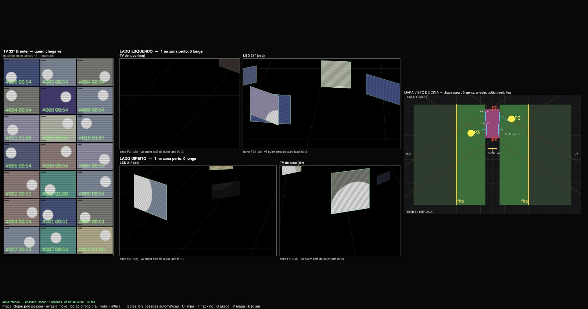
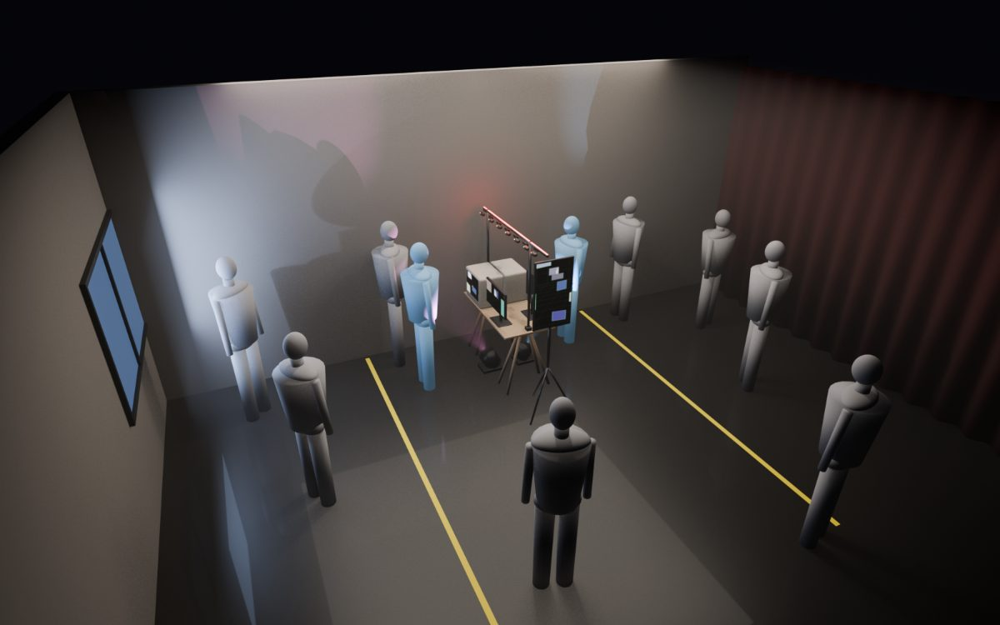
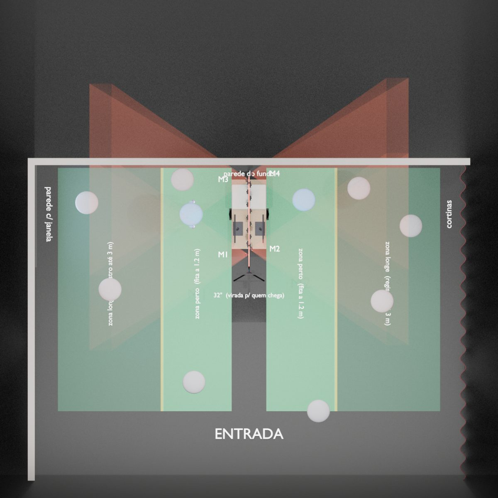
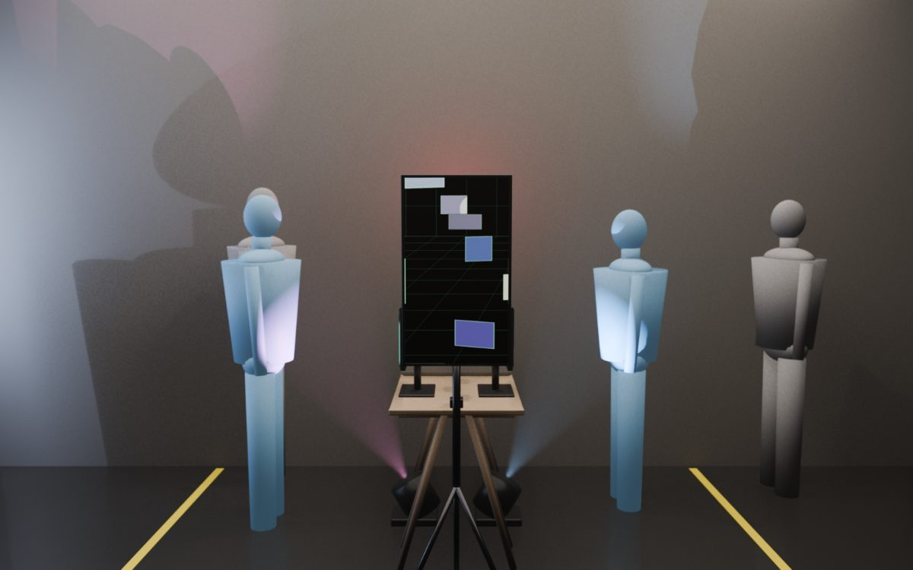
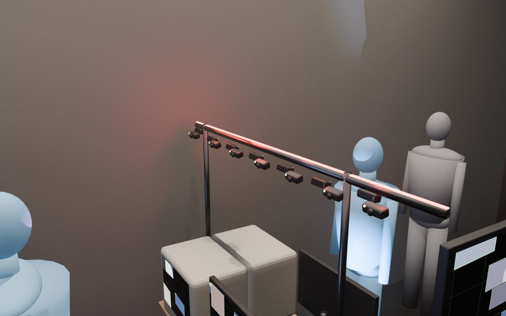

# Handover: OBSERVAÇÃO na montagem em ILHA (Gui → Phe, 11/11/2026)

**Para o Phe e para o Claude do Phe.** Este pacote leva o código da `main` de 10/11 para a montagem nova (ilha). O hardware não foi mexido. Nada disto rodou ainda com as câmeras reais: tudo foi testado no Mac, com câmeras e pessoas simuladas. **O próximo passo é teu: testar com as câmeras e ajustar o que precisar, código incluído.**

Enquanto isso, o Gui e o Claude dele começam a **UI da tela principal (a 32")**. Para não haver conflito, veja a seção 8.



---

## 0. Novidade da v2 (11/11): palpites sobre as pessoas

A 32" mostra uma **ficha de cada dono**: o rosto recortado e os palpites do sistema. São idade aparente (InsightFace, `models/genderage_insightface.onnx`; só a idade, gênero ignorado) e humor (FER+, `models/emotion-ferplus-8.onnx`), altura (do tracking), peso (inventado de propósito) e cor da roupa. Detalhes, fontes dos modelos e a qualidade de cada palpite estão em [`docs/ilha.md`](ilha.md#palpites-sobre-as-pessoas-v2-1111).

- **Código novo:** `src/observacao/analise.py`.
- **Mudança no tracker:** pequena, em `tracker.py`, só aditiva. Cada pessoa guarda o melhor recorte de rosto (`Tracker.rosto(pid)`).
- **Dependências:** nenhuma nova, só OpenCV.
- **Privacidade:** os palpites ficam só na memória e somem 60 s depois de a pessoa sair.
- **No teste com câmeras, conferir:**
  - a ficha aparece quando alguém vira dono;
  - o rosto recortado é o da pessoa certa;
  - a análise anda (`análise N/s` no rodapé do preview);
  - o desempenho continua bom com as 4 câmeras de tracking.

## 1. O que mudou desde o repo de 10/11

**Layout (decidido entre 10 e 11/11).** O U foi trocado por uma ilha:

- **Mesa:** mesa de cavaletes de 1,20 m, com o fundo quase encostado na parede do fundo (parede lisa). Ninguém passa por trás.
- **Telas costas com costas:** de cada lado, uma TV de tubo (perto da parede) e um LED 21" com pezinho (mais para a frente).
- **TV 32":** de pé na **frente** da mesa, virada para quem chega. É o "painel".
- **Público:** entra pela frente, em direção à 32", e circula só pelas **laterais**. Cada lateral tem ~3 m × 4–5 m.
  - Lateral esquerda: parede com janela, de frente para as telas da esquerda.
  - Lateral direita: cortinas.
- **Vara longitudinal sobre a mesa:** as **14 câmeras numa fila só, alternando esquerda/direita**.
  - **M1–M4 (tracking)**, nas pontas. Olham reto para o lado: M1/M3 para a esquerda, M2/M4 para a direita.
  - **10 câmeras de foto** no meio.
- **Luz:**
  - **Refletores PAR no chão**, debaixo da borda da mesa, um por lado, iluminando de baixo o rosto de quem está perto.
  - **Fita LED vermelha constante** em cima da vara, como luz de "gravando". Sugestão: fita USB 5 V num carregador de celular, **não** nas portas do PC.

Maquete 3D (gerada das mesmas medidas do programa) em [`docs/maquete/`](maquete/):

| | |
|---|---|
|  |  |
|  |  |

**Lógica por lado** (detalhes em [`docs/ilha.md`](ilha.md)). Cada lateral tem uma **zona perto** (até uma fita no chão, ~1,2 m da mesa) e uma **zona longe** (até ~3 m, só registro).

| No lado | As 2 telas daquele lado |
|---|---|
| ninguém na zona perto | grade das câmeras ao vivo, como parede de monitores (decisão do Gui, 11/11); quem cruza a fita transforma a grade em janela 3D |
| alguém na zona perto | o mais perto vira **dono** (só perde a tela para alguém ≥ 30 cm mais perto) |
| dono, primeiros 10 s | ele mesmo, ao vivo |
| dono, depois | **quem está do outro lado da mesa**; sem ninguém lá, a pessoa anterior, trocando a cada 35 s |
| dono há 5 min | o estado liga `alerta` (o efeito visual ainda não existe) |
| 4+ na zona perto | aquele lado vira mural |

A 32" mostra o mural, até a UI nova ficar pronta. Só quem entra na zona perto vira sessão no banco.

**Decisões da reunião de 10/11 já no código:**
- tracking pelo meio dos olhos;
- modo arquivo/mural;
- tempo de permanência e troca de perspectiva;
- sinal de alerta aos 5 min;
- 4 câmeras de tracking, 2 por lado.

**Ainda não feitas:** ver seção 8.

## 2. Como pegar

Duas opções, as duas sem commit:

- **Patch** (recomendado). Na pasta do repo, na `main` de 10/11 (commit `bf49c5e`):
  ```
  git apply --check observacao-ilha.patch
  git apply observacao-ilha.patch
  ```
  Depois `git status` mostra tudo o que mudou. O commit fica a teu critério.
- **Zip** `observacao-ilha.zip`: o projeto inteiro já com as mudanças, sem `.venv` e sem `bank`. Serve para comparar ou copiar por cima.

Não há dependência nova. O `requirements.txt` já basta: pyglet 2.x, opencv, numpy.

## 3. Rodar sem câmeras (o simulador)

```
cd src && ..\.venv\Scripts\python -m observacao.render.app --fake 10
```

Sem câmeras de tracking, o app abre em modo simulador:
- **32":** numa coluna, à esquerda.
- **Uma linha por lado:** TV de tubo e LED 21", na ordem em que quem está daquele lado vê. Embaixo de cada tela aparece o que ela está mostrando.
- **Mapa visto de cima:** à direita.

Interação no mapa:
- clique põe uma pessoa;
- arraste move;
- botão direito tira;
- roda do mouse muda a altura;
- teclas: `0`–`9` pessoas automáticas, `C` limpa, `T` tracking real, `G` grade, `V` mapa, `Esc` sai.

## 4. Teste com as câmeras: passo a passo

**4.1 USB: conta das câmeras abertas (importante).** O limite medido em 05/11 é de 2 webcams abertas por controlador, 3 controladores, ou seja, **6 no PC**. Com 4 de tracking, ficam:

| Controlador | Câmeras |
|---|---|
| CPU (azuis de trás) | M1, M2 |
| chipset B (frente) | M3, M4 (na vaga que era do `V1`) |
| chipset A (vermelhas/pretas) | rodízio de fotos, 2 vagas |

**`V1` já virou câmera de foto** no `cameras.json` (decisão do Gui, 11/11). Ela entra no rodízio, e por isso **precisa estar ligada no mesmo controlador das outras de foto** (chipset A): as câmeras de rodízio precisam estar todas no mesmo controlador (regra do `Rodizio` em `capture.py`). Com isso, o PC abre 4 de tracking + 2 vagas de rodízio = 6. O "ao vivo" da obra vem das 4 câmeras de tracking, que ficam abertas o tempo todo e já aparecem no 3D e na grade ao vivo.

**4.2 Cadastrar M3 e M4** com `tools/calibrate_cameras.py`, papel `master`. Hoje só existem M1 e M2. Os nomes precisam ser exatamente **M1–M4**: é por esse nome que o `config/ilha.json` diz onde fica cada uma.

**4.3 Medidas.** Medir com trena e digitar:
```
.venv\Scripts\python tools\configurar_ilha.py
```
- Pergunta uma medida por vez, e Enter mantém o valor atual.
- Avisa quando as medidas não fazem sentido juntas (zona longe menor que a perto, telas sobrepostas, câmera sem cadastro).
- Mostra o mapa.
- Os valores de agora são **estimativas**: mesa 120 × 60 × 75; telas no tampo; vara a 1,74 m; câmeras de tracking a 1,70 m.

**4.4 Fita no chão** a `zonas.perto_cm` (120) da borda da mesa, dos dois lados.

**4.5 Calibrar o tracking, um lado por vez:**
```
.venv\Scripts\python tools\calibrate_tracking.py --lado esq --olhos 160
.venv\Scripts\python tools\calibrate_tracking.py --lado dir --olhos 160
```
- Duas marcas no chão do lado escolhido, a 60 e a 150 cm da borda, no meio do comprimento da mesa.
- Fica em cada marca olhando para as telas daquele lado e aperta 1 e 2. Depois `s` salva.
- Grava `k_face`, `yaw` e `pitch` com `"calibrado": true` em `cameras.json`. A partir daí a calibração vale mais que a estimativa por medidas.
- Testei o cálculo com câmeras simuladas na geometria da ilha, e ele recuperou ângulo e escala exatos. Com câmera real, não.

**4.6 Ver funcionando:**
```
cd src && ..\.venv\Scripts\python -m observacao.render.app
cd src && ..\.venv\Scripts\python -m observacao.render.app --perfil evento --telas
```
- O primeiro é o preview com o tracking real e o mapa: o mapa mostra onde o sistema acha que cada pessoa está.
- O segundo são as telas físicas.

**4.7 Checklist do teste.** Anotar o que falhar:

- [ ] As 4 de tracking + 2 vagas do rodízio abrem juntas e ficam estáveis por 10 min.
- [ ] Ao andar na lateral, o ponto no mapa acompanha, e o lado está certo (esq/dir).
- [ ] A distância da mesa no mapa bate com a real, ±20 cm: a 60 cm, a 1,2 m e a 2,5 m.
- [ ] Ao cruzar a fita, a pessoa vira dona (status embaixo das telas) e as 2 telas daquele lado viram janela para ela. A paralaxe acompanha a cabeça.
- [ ] Duas pessoas, uma de cada lado: depois de 10 s, cada uma vê a outra.
- [ ] Mesma pessoa vista por M1 e M3 conta como **uma** só (raio de fusão de 45 cm em `app.json`).
- [ ] Na zona longe (2–3 m), o tracking pega rosto? A 3–4 m o rosto tem ~20 px numa webcam 640×480. Se não pegar, tudo bem, mas anote.
- [ ] Com a luz da festa (PAR no chão + fita vermelha), o rosto continua sendo detectado.
- [ ] A janela da lateral esquerda não ofusca as câmeras daquele lado. Se ofuscar, cobrir.

## 5. Onde mexer (à vontade)

Tudo pode ser ajustado. Os botões mais prováveis:

| Ajuste | Onde |
|---|---|
| medidas, zonas, tempos (10 s / 35 s / 5 min / lotação) | `config/ilha.json` (via `tools/configurar_ilha.py --set ...`) |
| alcance e quantidade de pessoas no tracking | `config/profiles/ilha.json` e `evento.json` (`distancia_max_cm` 450, `max_pessoas` 12) |
| confiança, suavização e fusão do tracking | `config/app.json` → `tracking` |
| direção padrão das câmeras de tracking | `ilha.py` → `Ilha._master` (hoje: reto para o lado; a calibração corrige) |
| regras de quem vê quem | `estado_ilha.py` |

O app do U antigo continua em `render/app_u.py`, só como referência.

## 6. Como devolver para o Gui

Depois do teste, manda:
- `config/ilha.json` e `config/cameras.json`;
- prints do preview, com o mapa;
- a lista do checklist com o que falhou;
- o diff, se mexer no código.

## 7. Pontos frágeis conhecidos

- **Distância pelo tamanho do rosto:** é aproximada. Na zona perto funciona bem; na longe, erra mais. A lógica foi feita para isso: só manda quem está mais perto.
- **Fusão M1+M3 no mesmo lado:** depende de as duas estarem bem calibradas. Se a mesma pessoa aparecer duas vezes no mapa, a primeira coisa a fazer é recalibrar aquele lado.
- **Luz colorida:** os PAR e a fita vermelha mudam a imagem. A detecção de rosto costuma aguentar, mas vale testar. A exposição das câmeras pode ser travada por câmera em `cameras.json`.
- **Câmeras de foto viradas para fora:** pegam muita costas e muito vazio. O filtro 80/20 ainda não existe.

## 8. Divisão do trabalho até sábado

| Quem | O quê |
|---|---|
| **Phe** | câmeras, USB, cadastro M3/M4, medidas, calibração, tracking, luz, montagem. Pode mexer em `capture.py`, `tracker.py`, `tools/*`, `config/*`, `ilha.py`, `estado_ilha.py` |
| **Gui + Claude** | **UI da tela principal (32")**: rosto do dono em destaque, ficha de palpites, contador, alerta de 5 min com falha visual, mural. Vai entrar num módulo novo (`render/painel.py`). Para evitar conflito, **não mexa em `render/archive.py`, `analise.py` nem no trecho da 32" em `render/app.py`** (`lado == "frente"` no `on_draw` e `_desenhar_fichas`) |
| a decidir | filtro 80/20 das fotos; cor das TVs de tubo por software; frases |

---

## Para o Claude do Phe

- **Referencial do mundo** (o mesmo do tracker, em cm): origem no chão, no centro da mesa; x para a direita de quem chega; y para cima; z para a frente (a entrada); `yaw` 0 olha para +z. Lado esq = x < 0. A 32" fica em z positivo, com yaw 0.
- **`ilha.py`** transforma medidas (`config/ilha.json`, mesclado sobre `PADRAO`) em telas no formato antigo do `screens.json` e na pose das masters. `config.carregar("ilha")` aplica essas poses nas entradas de `cameras.json` com o mesmo nome, só em memória e só quando a câmera não está `"calibrado": true`.
- **Cada lado tem um referencial local** (`Lado.local()`): uma rotação em y que deixa as telas daquele lado olhando para +z'. Por isso `projection.py` (Kooima), `scene.py` (`Cena`) e `limitar_olho` funcionam **sem mudança**. O app tem **uma `Cena` por lado** e só limita o olho pelas telas do próprio lado. Antes ele limitava por todas, o que é impossível com telas costas com costas.
- **`estado_ilha.EstadoIlha.atualizar(pessoas)`** devolve `{"lados": {esq/dir: {modo, fase, dono, alvo, segundos, alerta, perto, longe}}, "pessoas": [...com lado/dist/zona], "telas": {id: lado}, "alerta": bool}`. `alvo` None quer dizer câmeras ao vivo.
- **Testes rápidos sem hardware:**
  - simulador: `--fake 10 --pessoas 6 --print saida.png --print-s 30` salva um print e sai;
  - configurador: `tools/configurar_ilha.py --ver --sem-janela` imprime resumo e avisos.
- **No Mac**, o projeto só roda trocando `observacao.devices` (que é DirectShow/comtypes) por um stub. No Windows não precisa.
- **Maquete:** `blender -b -P tools/maquete_ilha_blender.py` regera `docs/maquete/` a partir de `config/ilha.json`. Útil depois das medidas de sexta.
- **Convenções do projeto:** tudo em português, nada de posição fixa no código (tudo em `config/`), e o código antigo do U preservado em `render/app_u.py`.

### Arquivos

| | Arquivo |
|---|---|
| novo | `src/observacao/analise.py` e `models/genderage_insightface.onnx`, `models/emotion-ferplus-8.onnx` (v2), `src/observacao/ilha.py`, `src/observacao/estado_ilha.py`, `tools/configurar_ilha.py`, `tools/maquete_ilha_blender.py`, `config/ilha.json`, `config/profiles/ilha.json`, `docs/ilha.md`, `docs/HANDOVER_ilha.md`, `docs/maquete/*`, `src/observacao/render/app_u.py` (cópia do app antigo) |
| alterado | `src/observacao/tracker.py` (v2: guarda o recorte do rosto), `config/app.json` (v2: seção `analise`), `src/observacao/render/app.py` (render da ilha + simulador + ficha provisória), `src/observacao/config.py` (perfil com `"ilha"`), `tools/calibrate_tracking.py` (`--lado`, padrão perfil `ilha`), `src/observacao/phrases.py` (distância), `config/profiles/evento.json` (ilha), `README.md`, `.gitignore` |
